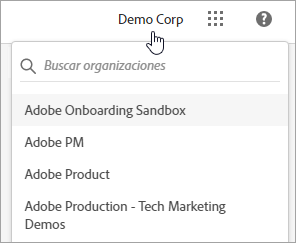
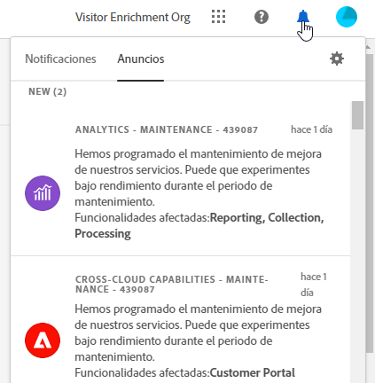
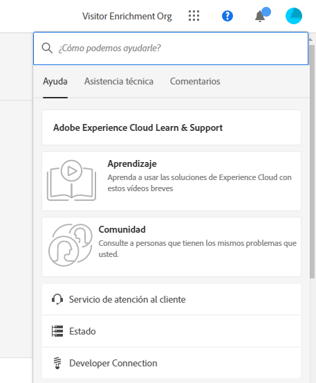

# Introducción a CX Enterprise {#get-started}

Inicia sesión en [Adobe CX Enterprise](https://experience.adobe.com) para iniciar tus aplicaciones, luego usa el encabezado unificado para administrar tu perfil, comprueba las notificaciones y encuentra ayuda, todo desde un solo lugar.

## Antes de empezar {#before-you-begin}

Necesita un Adobe ID que se haya aprovisionado para los productos de CX Enterprise de su organización. Si no puedes iniciar sesión o no ves las aplicaciones que esperas, ponte en contacto con tu [!UICONTROL CX Enterprise] [administrador](administration/admin-console.md).

## Iniciar sesión en CX Enterprise {#sign-in}

Inicie sesión y verifique que se encuentra en la [organización](administration/organizations.md) correcta.

1. Vaya a [Adobe CX Enterprise](https://experience.adobe.com).
1. Escriba su dirección de correo electrónico de Adobe y haga clic en **[!UICONTROL Continuar]**.
1. Haga clic en una cuenta.
1. Escriba la contraseña.
1. Compruebe que se encuentra en la organización correcta.

   

   **Verifique su organización**

   La [organización](administration/organizations.md) se muestra en el encabezado de la interfaz.

   Si su organización utiliza Federated ID, CX Enterprise le permite iniciar sesión con el inicio de sesión único de su organización sin necesidad de escribir su dirección de correo electrónico y contraseña. Agregue `#/sso:@domain` a la dirección URL de CX Enterprise (`https://experience.adobe.com`) para realizar esta tarea.

   Por ejemplo, para una organización con Federated IDs y el dominio `example.com`, establezca el vínculo URL en `https://experience.adobe.com/#/sso:@example.com`. También puede ir directamente a una aplicación específica marcando esta URL, anexada con la ruta de la aplicación. (Por ejemplo, para Adobe Analytics, `https://experience.adobe.com/#/sso:@example.com/analytics`).

   **Nota:** El administrador de su organización puede restringir el acceso a los productos de Adobe por direcciones IP. Si es así, es posible que reciba un error después de iniciar sesión en CX Enterprise o de cambiar a una organización con esto habilitado. Encontrará más información en [Limitar el acceso al producto por direcciones IP](https://helpx.adobe.com/es/enterprise/using/ip-based-access.html).

## Acceso a aplicaciones de CX Enterprise {#applications}

Después de iniciar sesión en CX Enterprise, puede acceder rápidamente a todas sus aplicaciones, servicios y organizaciones desde el encabezado unificado.

Para acceder a las aplicaciones y servicios de CX Enterprise proporcionados por usted dentro de su organización, vaya al selector de aplicaciones .

## Administrar el perfil de usuario {#profile}

En el menú [!UICONTROL Perfil], puede:

* Especifique un tema oscuro (no todas las aplicaciones admiten este tema)
* Administrar CX Enterprise [Preferencias](features/account-preferences.md)
* Seleccione o busque una [organización](administration/organizations.md)
* Ver [!UICONTROL avisos legales]
* Cerrar sesión
* Configurar las preferencias, notificaciones y suscripciones de la cuenta

## Ver notificaciones y anuncios dentro del producto {#notifications}

Haga clic en el icono de la campana para ver las notificaciones y los anuncios. Los anuncios pueden ser actualizaciones relevantes y procesables, entre ellas versiones de productos, avisos de mantenimiento, elementos compartidos y solicitudes de aprobación.

Para administrar notificaciones y alertas, consulte [Preferencias y notificaciones de la cuenta](features/account-preferences.md).

## Obtener ayuda y asistencia {#help}

Acceda a aprendizaje y ayuda mediante el **[!UICONTROL Centro de ayuda]** () del encabezado, que incluye contenido de ayuda (documentación, tutoriales y cursos) en [Experience League](https://experienceleague.adobe.com/es?lang=es#home), así como recursos adicionales para aplicaciones individuales. También puede enviar comentarios abiertos y crear tickets de asistencia con prioridad.

El menú [!UICONTROL Ayuda] también te da acceso a:

* **[!UICONTROL Soporte técnico]:** Cree un vale de soporte técnico o póngase en contacto con el [!UICONTROL Soporte técnico] a través de Twitter.
* **[!UICONTROL Comentarios]:** Comparte comentarios sobre tu experiencia de CX Enterprise. Los comentarios se utilizan para mejorar los productos y servicios de Adobe.
* **[!UICONTROL Estado]:** Vaya a `https://status.adobe.com/es-es/experience_cloud` y compruebe el estado operativo del producto y [!UICONTROL Administrar suscripciones].
* **[!UICONTROL Developer Connection]:** Navegación a `adobe.io` y búsqueda de documentación para desarrolladores.

## Más ayuda sobre este tema {#more-help}

* [Administración de usuarios y productos en Admin Console](administration/admin-console.md)
* [Introducción al servicio People](services/getting-started.md)
* [Preferencias y notificaciones de la cuenta](features/account-preferences.md)
