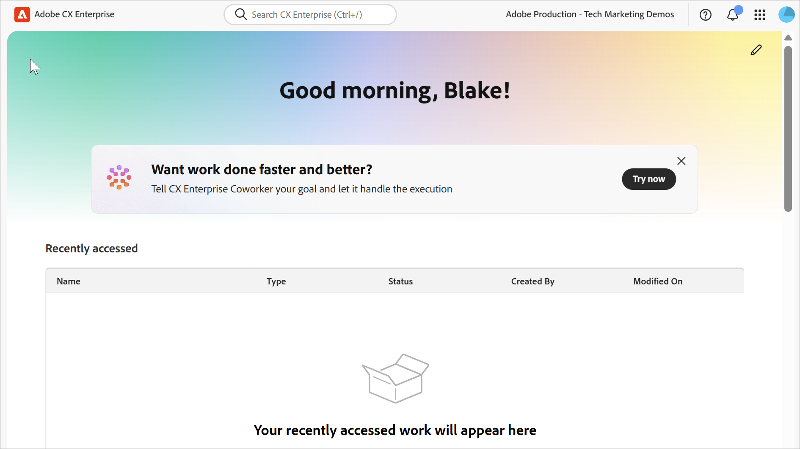

# Interfaz de Adobe CX Enterprise y guía de administración

[Adobe CX Enterprise](https://experience.adobe.com) (Customer Experience Enterprise) conecta las aplicaciones de Adobe para el contenido, la participación, los datos y la visibilidad de la marca en flujos de trabajo impulsados por el agente, de modo que pueda organizar la experiencia del cliente desde un sistema integrado.

## Qué puede hacer con CX Enterprise {#capabilities}

CX Enterprise reúne aplicaciones para cada fase del ciclo vital de la experiencia del cliente:

| Capacidad | Lo que puede hacer |
| --- | --- |
| Orquestación del trabajo con agentes de IA | Use [Adobe CX Enterprise Coworker](https://experienceleague.adobe.com/es/docs/cx-enterprise-ai/experience-cloud-ai/coworker/overview) para automatizar la experiencia del cliente y los flujos de trabajo de marketing con agentes que actúen dentro de las protecciones establecidas. |
| Captación de clientes en tiempo real | Unifique los datos de los clientes y organice recorridos personalizados con [Adobe Real-Time CDP](https://experienceleague.adobe.com/docs/experience-platform/rtcdp/overview.html?lang=es) y [Adobe Journey Optimizer](https://experienceleague.adobe.com/es/docs/journey-optimizer/using/get-started/get-started), y pruebe y personalice experiencias con [Adobe Target](https://experienceleague.adobe.com/docs/target.html?lang=es). |
| Crear y administrar contenido a escala | Planifique, produzca y gobierne contenido con [Adobe GenStudio for Performance Marketing](https://experienceleague.adobe.com/es/docs/genstudio-for-performance-marketing/user-guide/get-started), [Adobe Experience Manager](https://experienceleague.adobe.com/docs/experience-manager-cloud-service.html?lang=es) y [Adobe Workfront](https://experienceleague.adobe.com/es/docs/workfront/using/basics/home/home). |
| Medir y optimizar | Analizar datos de experiencia en varias aplicaciones con [Adobe Analytics](https://experienceleague.adobe.com/docs/analytics.html?lang=es). |
| Vender en línea | Ejecute comercio digital con [Adobe Commerce](https://experienceleague.adobe.com/docs/commerce.html?lang=es). |
| Proteger y aumentar la visibilidad de la marca | Monitoriza y mejora la apariencia de tu marca en búsquedas y conversaciones basadas en IA con [Adobe Brand Visibility](https://experienceleague.adobe.com/es/docs/brand-visibility/using/essentials/overview). |
| Administración de datos y administración | Recopile, gobierne y active datos entre aplicaciones en [Adobe Experience Platform](https://experienceleague.adobe.com/docs/experience-platform.html?lang=es). |

{style="table-layout:auto"}

Esta guía describe la interfaz compartida y la capa de administración que une estas aplicaciones, no las características de cada aplicación individual.

## La interfaz de CX Enterprise {#interface}

En el encabezado de CX Enterprise puede hacer lo siguiente:

* [Acceda](get-started-using-cxe.md#applications) a todas sus aplicaciones y servicios de CX Enterprise
* En el menú **[!UICONTROL Ayuda]**, busque documentación del producto, tutoriales y publicaciones de la comunidad. Ver resultados en Experience League.
* [buscar](/help/interface/features/search.md) objetos empresariales globalmente utilizando una búsqueda global (solo usuarios de Experience Platform) en el campo Buscar.
* Obtener acceso a [Admin Console](/help/interface/administration/admin-console.md) para la administración de usuarios y productos
* Administración de las [preferencias](features/account-preferences.md) de la cuenta (alertas, notificaciones y suscripciones)

Para iniciar sesión, iniciar aplicaciones y familiarizarse con la interfaz, consulte [Introducción a CX Enterprise](get-started-using-cxe.md).

